# FreeCAD Furniture Boards

Draw the front view of a piece of furniture as one quick sketch — overlapping
lines, T-junctions, nothing trimmed — and get every board as a solid, between
two planes you choose. Change the sketch or move a plane and all boards
update.

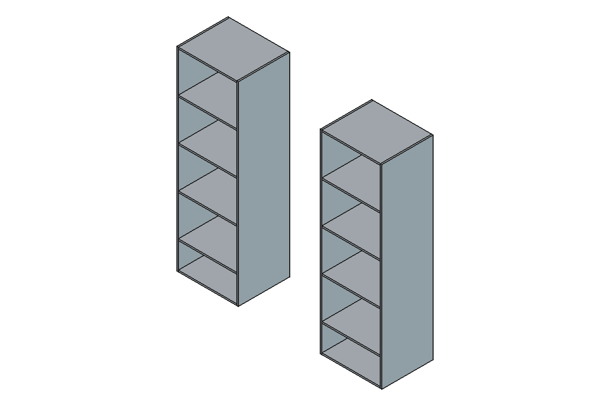

The idea: every sketch line is extruded as a surface, the planes close the
space front and back, and the surfaces split that space into closed volumes.
You then choose which volumes are boards.

Tested with FreeCAD 1.1.

## Contents

| File | What it is |
|---|---|
| `furniture_boards.py` | The code: `Cells` and `Boards` parametric objects |
| `MakeBoards.FCMacro` | Macro: build `Cells` + `Boards` from the selected tools |
| `ToggleBoard.FCMacro` | Macro: add/remove the clicked volume(s) from `Boards` |
| `ExplodeBoards.FCMacro` | Macro: one object per board that keeps tracking its board (use instead of *Explode compound*) |
| `flat_pack.py` | The code: `FlatPack` and `FlatSheet` parametric objects |
| `LayFlat.FCMacro` | Macro: lay all pieces flat, one sheet per thickness |
| `example/vestidor-example.FCStd` | The example used in this manual |
| `tools/make_screenshots.py` | Regenerates the screenshots and the example file |

## Install

FreeCAD 1.1 only reloads saved Python objects whose code lives in an
**installed addon** (the `Mod` folder). Code in the `Macro` folder works while
you use it, but a saved file would come back broken. So install the repo as an
addon and link the two macros:

```bash
FC=~/.local/share/FreeCAD/v1-1        # FreeCAD 1.1 user folder on Linux
ln -s ~/dev/freecad-furniture-boards                     $FC/Mod/FurnitureBoards
ln -s ~/dev/freecad-furniture-boards/MakeBoards.FCMacro  $FC/Macro/
ln -s ~/dev/freecad-furniture-boards/ToggleBoard.FCMacro $FC/Macro/
ln -s ~/dev/freecad-furniture-boards/ExplodeBoards.FCMacro $FC/Macro/
ln -s ~/dev/freecad-furniture-boards/LayFlat.FCMacro     $FC/Macro/
```

Restart FreeCAD. Because these are symlinks, editing the repo updates FreeCAD
directly.

Optional: *Tools → Customize → Macros* lets you turn the macros into
toolbar buttons.

## Usage

### 1. Draw the front sketch

Draw the front view on the XZ plane. Draw each board as its outline, for example
two lines 15 mm apart for a shelf. Lines may cross, overlap and end in the
middle of other lines. Construction lines are ignored.

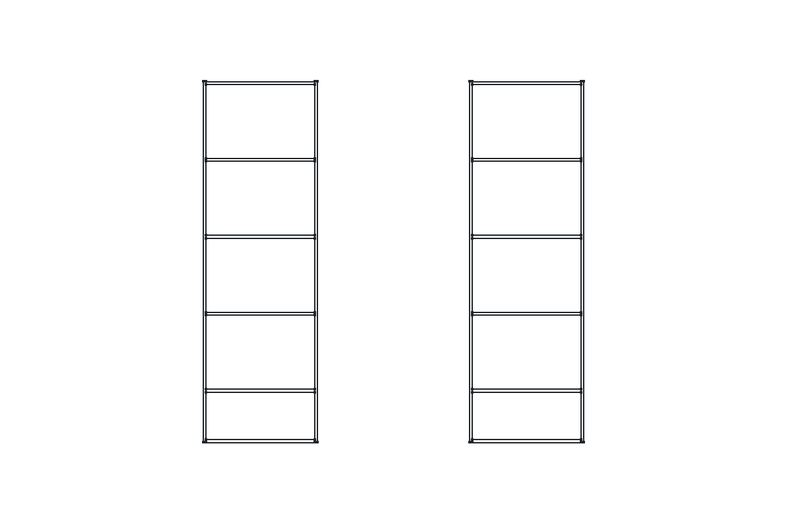

### 2. Add the back plane

The sketch plane (XZ) is the front limit. Create a datum plane for the back,
e.g. *PartDesign → Create a datum plane* attached to `XZ_Plane` with an
*Attachment Offset* Z of −500 mm for 500 mm deep boards. You can drive that
offset from a spreadsheet.

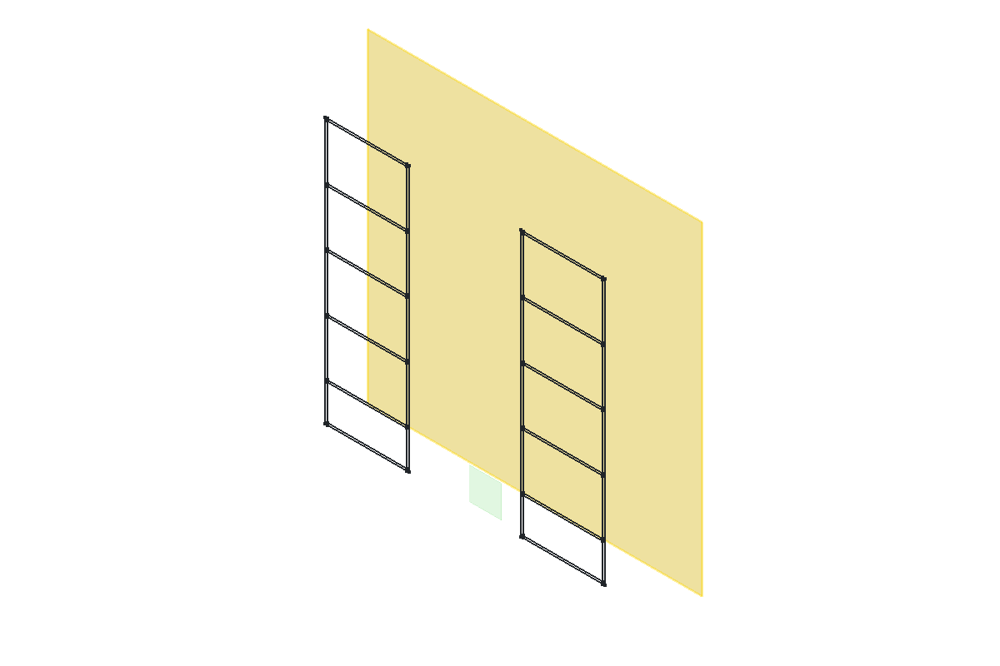

*The yellow plane is the back plane. `XZ_Plane` is the small green square at
the origin. It is infinite for this tool, whatever size FreeCAD draws it.*

### 3. Run MakeBoards

In the tree, select the sketch, `XZ_Plane` and the back plane (Ctrl+click),
then *Macro → Macros… → MakeBoards.FCMacro → Execute*.

The macro creates two objects:

- **`Cells`**: every closed volume enclosed by the tools, shown transparent.
  Volumes that are not closed on all sides, such as the gap between the two
  cabinets, are discarded.

  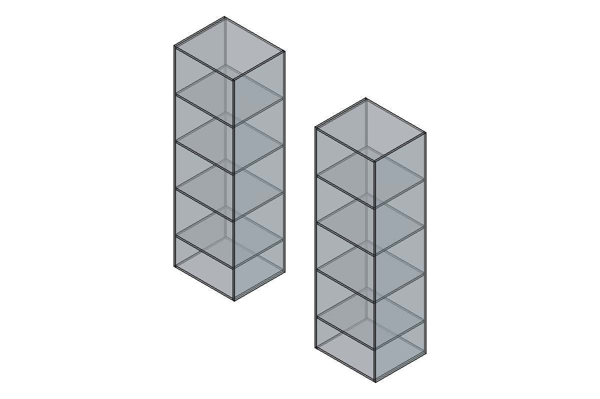

- **`Boards`**: the volumes you keep. By default these are the thin ones
  (boards); the big ones (compartments) are dropped.

  

Accepted tools (`Cells.Tools`, editable later in the property editor):

| Tool | How it's used |
|---|---|
| Sketch | Every line is extruded along the sketch normal as an unbounded surface |
| Plane (`XZ_Plane`, datum planes) | An unbounded plane |
| Anything with faces (Part Extrude with *Create solid* off, etc.) | Its faces, as they are |

You can use more than one sketch. For example, a side-view sketch on the YZ
plane can make shelves shallower than the sides, or leave a slot for a back
panel.

### 4. Choose the boards

`Boards` starts from a **Base** set, then **toggles** flip individual volumes.

| Base | Starting set |
|---|---|
| `Thin` (default) | Volumes whose smallest side ≤ `MaxThickness` (default 30 mm) |
| `All` | Every volume. Use this if you want everything and sort it yourself |
| `None` | Nothing. Pick every board by hand |

To flip a volume, click one of its faces in the 3D view and run
*ToggleBoard.FCMacro*. Ctrl+click selects several faces at once.

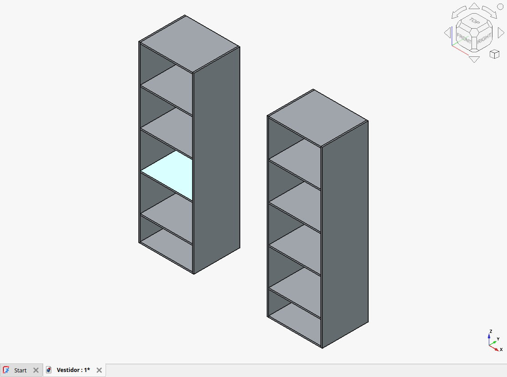

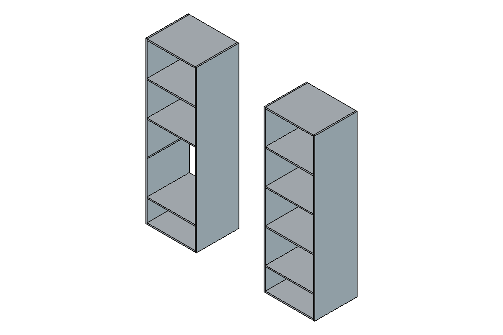

- On `Boards`, click a face of a board you want to remove. Any face works
  except one where two boards touch.
- To add a compartment back, show `Cells` (Space bar) and click one of its
  **outside** faces, front or back. Inside faces belong to two volumes, so
  they are ambiguous and the macro warns you.
- Each toggle is stored as a 3D point inside the volume, in
  `Boards.Toggled`. It survives design changes as long as the point stays
  inside the same board. If you move a board by more than about half its
  thickness, toggle it again. To clear all toggles, empty `Toggled`.

### 5. Read the results

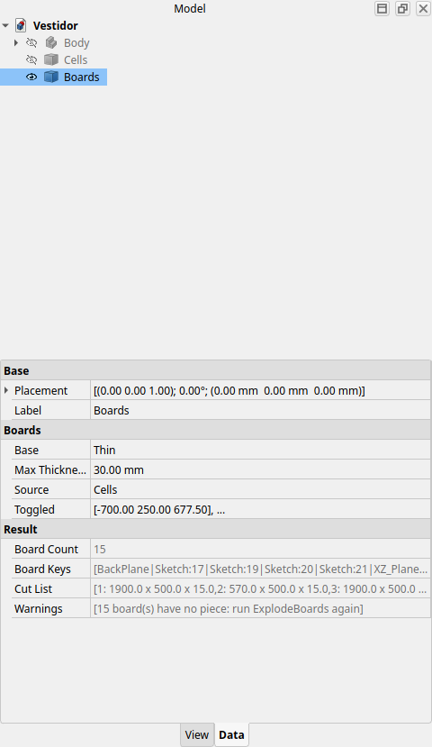

- `Boards.BoardCount`: number of boards.
- `Boards.CutList`: one line per board, `length x width x thickness` in mm.
  This is your cutting list.
- `Cells.CellCount`: number of closed volumes found.

For one object per board, see [Separate boards](#5b-separate-boards-explodeboards).
To join touching boards, see [Combining boards](#5c-combining-touching-boards-into-one).

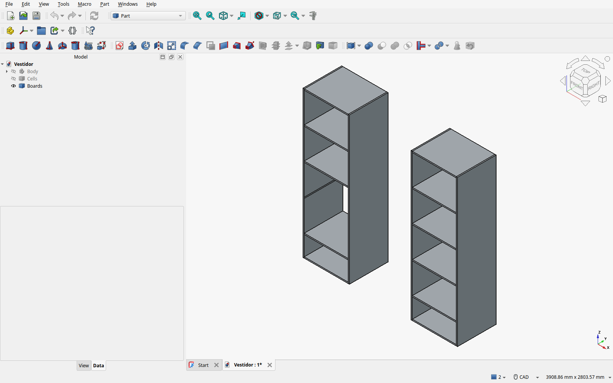

### 5b. Separate boards: ExplodeBoards

To get one object per board, for example to fuse two boards, color them or
export them one by one, select `Boards` and run *ExplodeBoards.FCMacro*. It
creates a **Boards pieces** group with one `BoardPiece` per board and hides
`Boards`.

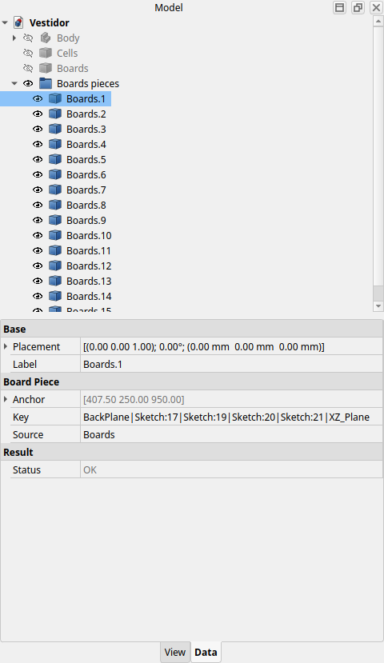

> **Don't use *Part → Compound → Explode compound* on `Boards`.** It tracks
> boards by their position in the list (piece 0, 1, 2…). When you add or
> remove a board, the list order changes. Pieces then silently switch to
> other boards, and new boards never show up. If you already used it, run
> *ExplodeBoards*. It converts those pieces, keeps their names and anything
> built from them (fusions etc.), and deletes the old ones.

**How a piece knows its board.** Every volume gets an identity: the list of
surfaces that enclose it. A shelf, for example, is enclosed by its two
sketch lines, the two side lines, the front plane and the back plane. You
can see these in `Boards.BoardKeys` and `Cells.CellKeys`. Each sketch line
is identified by its sketcher geometry id, which never changes. So:

| You change… | Pieces |
|---|---|
| Move lines, change depth, edit spreadsheet values | Follow their boards |
| Add a board | Existing pieces untouched. `Boards.Warnings` says a board has no piece. Run *ExplodeBoards* again: it adds only the missing ones |
| Delete a board's line | That piece becomes empty, with `Status` = "Board no longer exists". Delete it (and fix whatever used it) |
| Delete a line and draw a new one in its place | The piece's ID is gone, so it falls back to `Anchor`, a point inside the board, and adopts the new ID |

Running *ExplodeBoards* again never duplicates pieces.

### 5c. Combining touching boards into one

Two boards that touch become one board in one of two ways. Pick one way per
board. **Don't mix them**: if the sketch merges two boards that a Union was
built from, one of the Union's inputs disappears and the Union breaks.

**A. In the sketch (preferred when the seam has no reason to exist).** Two
touching boards are separate because a sketch line runs between them, for
example a divider line that crosses a shelf. Make that line stop at the
board:

- Select the line and *Toggle construction* if it isn't needed anywhere
  else. Construction lines are ignored.
- Otherwise use the Sketcher *Trim* or *Split* tool, and set the piece of
  line that lies inside the board to construction, or delete it.

The two volumes become one board on recompute. If you had run
*ExplodeBoards*, one of the two pieces takes over the merged board. The
other one gets `Status` = "Board no longer exists", so delete it.

**B. Fuse the pieces (when the sketch must keep the line).**

1. Run *ExplodeBoards* (see [5b](#5b-separate-boards-explodeboards)).
2. Ctrl+click the touching pieces and use *Part → Boolean → Union*.
3. On the new `Fusion`, set **Refine = true** in the property editor. This
   removes the seam, so the result is a single clean solid.

The Union follows the design: move the board's lines and it moves with
them. *LayFlat* counts it as one board, because it uses the end result and
skips the pieces it was built from. Touching boards that are not in one
plane, like a side and a top forming an L, can't be cut from one sheet.
*LayFlat* puts those on its **Not flat** sheet.

### 6. Lay the pieces flat

Run *LayFlat.FCMacro*. It lays every piece flat, groups pieces by
thickness, and puts one sheet per thickness in front of the model, inside a
**Flat pack** group.

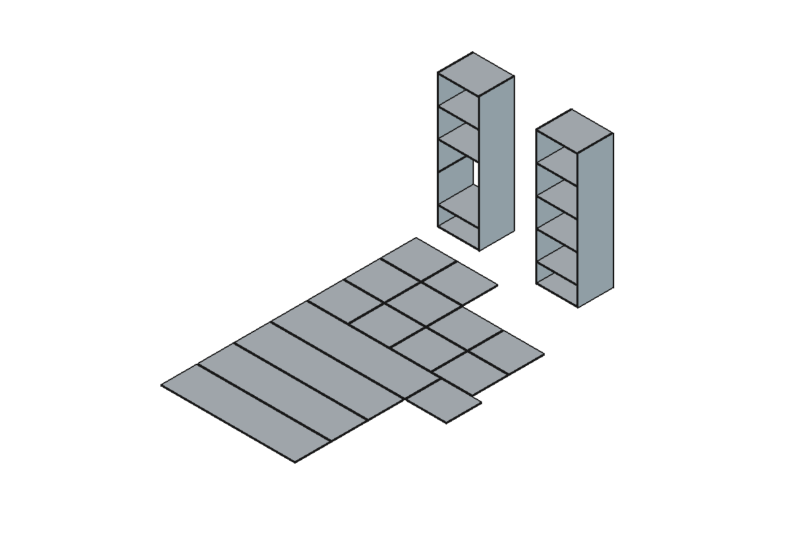

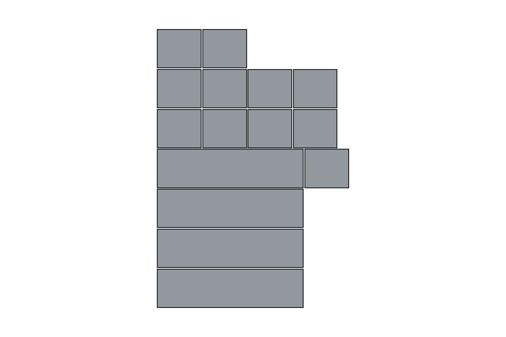

**Which pieces it uses:**

- **Nothing selected:** every visible object that has solids. This is
  usually what you want. *ExplodeBoards* and *Boolean* operations hide
  their inputs, so whatever you edited after `Boards` is what is visible.
- **Something selected:** only the selected objects.
- Every solid inside an object is one piece. If you select both an object
  and something built from it, for example `Boards` and its pieces,
  or two pieces and their fusion, only the end result is counted, so nothing
  is counted twice.

**How a piece is laid flat:**

- Its biggest flat side faces down.
- Its longest straight edge runs along X.
- Pieces are placed in rows, longest first. A new row starts after
  `RowLength` (2500 mm by default).

`Gap` and `GroupGap` on `FlatPack` set the spacing between pieces and
between groups.

Pieces that are not flat boards, for example two boards fused into an L,
go to a separate **Not flat** sheet and are listed in `FlatPack.Warnings`.

**Staying up to date:**

- The sheets are live. When you change the sketch, the planes or `Boards`,
  or edit the pieces, every sheet recomputes.
- If the set of thicknesses changes (a new 18 mm board, or no 15 mm boards
  left), `FlatPack.Warnings` tells you to run *LayFlat* again.
- Running it again reuses the same **Flat pack**. It adds missing sheets,
  removes empty ones and updates the source list. It never creates a second
  set of sheets.

Each sheet's `Pieces` property lists every piece as `n: source  length x
width  at (x, y)`, where `(x, y)` is measured from the sheet's corner:

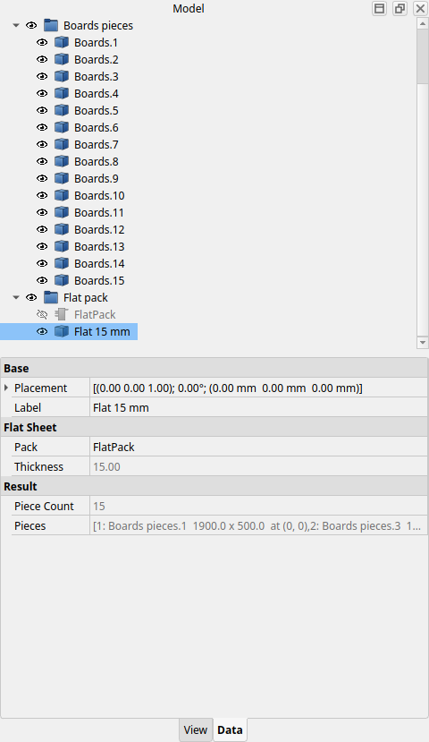

**Using the sheets:**

- **Cutting/CNC:** select a sheet and use *File → Export* (DXF or SVG), or
  make a *TechDraw* top view of it. Both stay linked to the model.
- **Optimizing material use:** the row layout keeps pieces organized, but it
  does not try to fit them onto stock boards. For that, take
  `Boards.CutList` to a panel cutting optimizer.

## Changing the design

Edit the sketch, move a plane, or change a spreadsheet value, then
recompute. `Cells` and `Boards` follow. Things to check after a change:

- A missing board usually means a line is missing, so the volume is not
  closed. It is then dropped, like the gap between two cabinets.
- `MaxThickness` decides board versus compartment. A gap thinner than
  `MaxThickness`, such as a drawer clearance, would count as a board. Toggle
  it off, or lower `MaxThickness`.

## Troubleshooting

| Symptom | Cause / fix |
|---|---|
| `blocked import of module 'furniture_boards' during document restore` | The repo isn't installed in `Mod/` (see [Install](#install)). Install it and restart FreeCAD |
| `MakeBoards: select sketches/planes/surfaces first` | Nothing was selected in the tree |
| `ToggleBoard: FaceN is shared by 2 volumes` | You clicked an inside face. Click an outside face |
| `Cells` is empty | The tools enclose no closed volume. You need a front and a back limit, plus closed outlines |
| Pieces show the wrong board, or a new board is missing, after *Explode compound* | Run *ExplodeBoards*. It converts them (see [5b](#5b-separate-boards-explodeboards)) |
| `Boards: 1 board(s) have no piece` | You added a board after exploding. Run *ExplodeBoards* again |
| A piece is empty, `Status` = "Board no longer exists" | Its board was removed from the design. Delete the piece |
| A piece is on the **Not flat** sheet | It isn't a single flat board. Fusing two boards into an L does this. Check `FlatPack.Warnings` |
| `Flat 18 mm: no sheet yet, run LayFlat again` | The design now has a new thickness. Run *LayFlat* again |

## Regenerating screenshots

```bash
cd ~/dev/freecad-furniture-boards
FREECAD_USER_HOME=$(mktemp -d) FB_REPO=$PWD \
    xvfb-run -a -s "-screen 0 1600x1000x24" ~/Apps/freecad.appimage tools/make_screenshots.py
cat docs/screenshots.log   # "OK boards=15 cells=26 flat=15"
```
